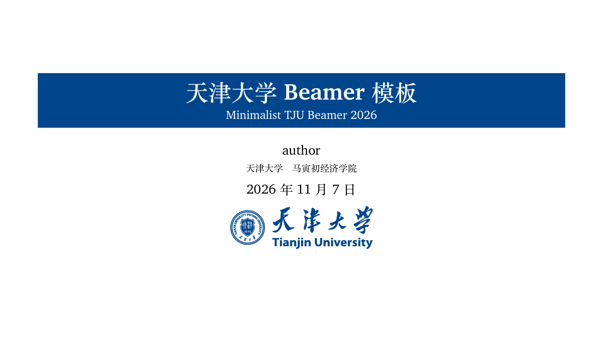
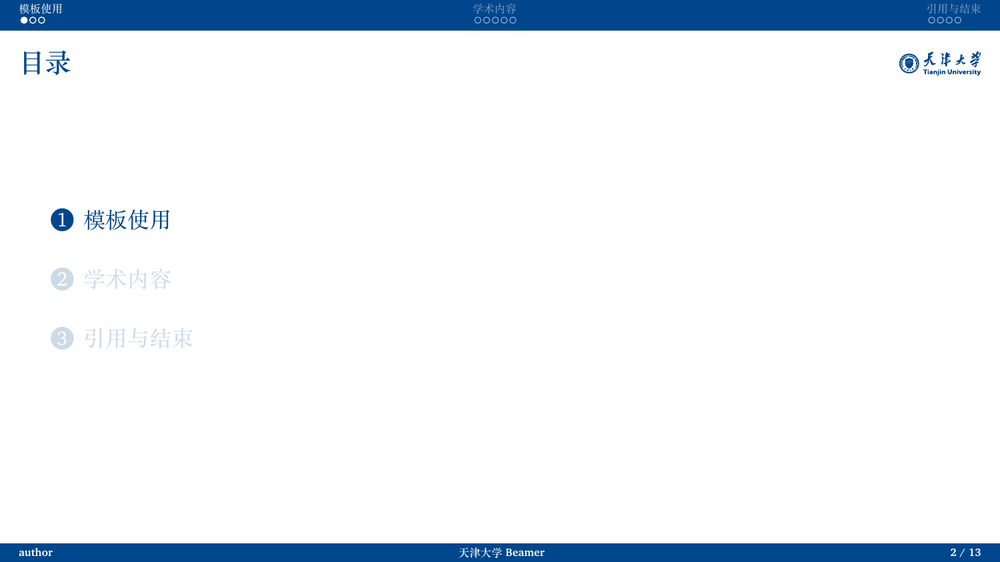
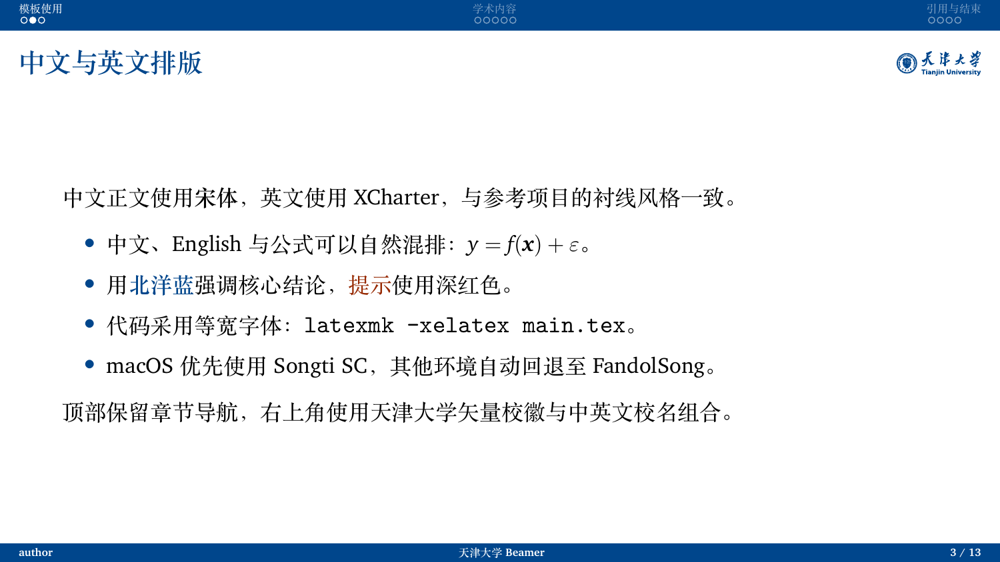
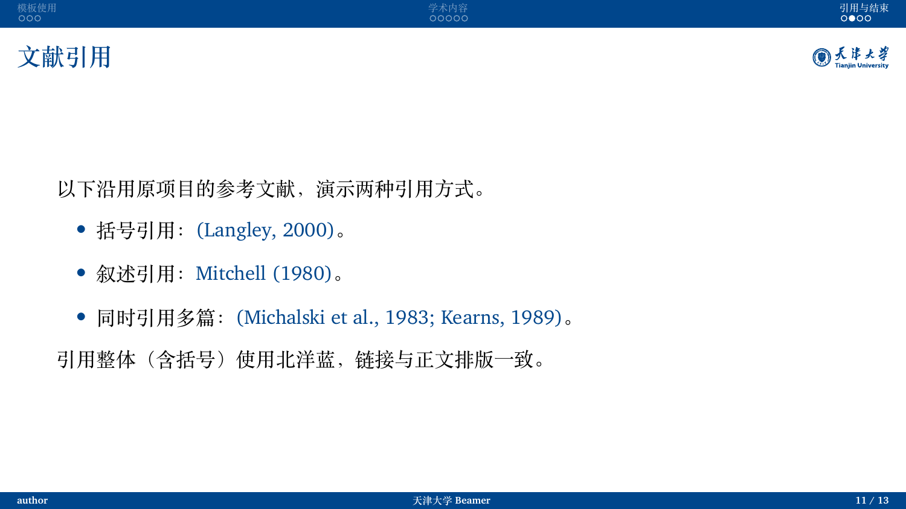
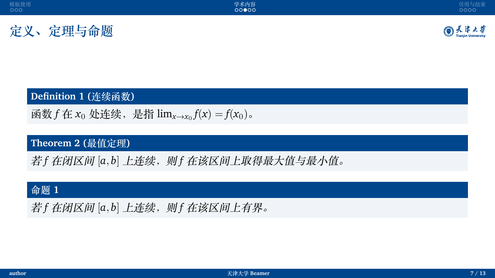
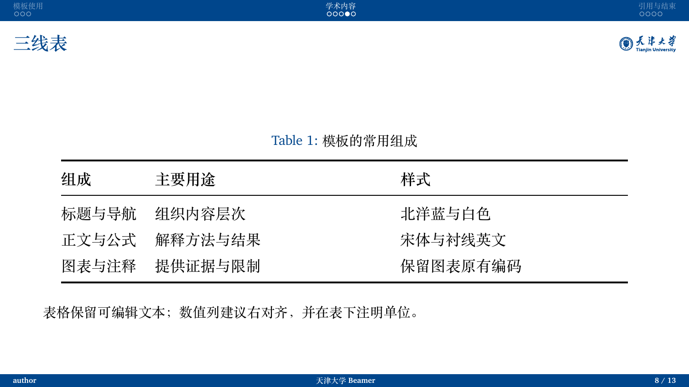

# Minimalist TJU Beamer 2026

天津大学风格的轻量 LaTeX Beamer 模板，采用北洋蓝、衬线排版和原生中文支持。
A lightweight Tianjin University Beamer template with Peiyang blue, serif typography and native Chinese support.

基于 [rexera/minimalist-pku-beamer-2026](https://github.com/rexera/minimalist-pku-beamer-2026/) 改编，沿用其简洁版式，并替换为天津大学视觉元素。
Adapted from [rexera/minimalist-pku-beamer-2026](https://github.com/rexera/minimalist-pku-beamer-2026/), retaining its minimalist layout and introducing Tianjin University colors and visual identity.

---

## 预览 · Preview

| 标题页 Title | 目录页 Section TOC | 中文排版 Chinese |
| :---: | :---: | :---: |
|  |  |  |

| 引用着色 Citations | 定理环境 Theorems | 表格 Tables |
| :---: | :---: | :---: |
|  |  |  |

## 特性

- **天津大学配色**：以北洋蓝 `#00468C`（RGB 0/70/140）统一封面标题框、章节导航、正文标题和页脚，正文保持白底。
- **原生中文**：主题自动加载 `ctex`（`fontset=none`、`scheme=plain`）。macOS 优先使用宋体 Songti SC，其他环境回退为 FandolSong，支持中英混排、中文粗体与伪斜体。
- **衬线英文**：通过 `fontspec` 按字体文件名加载 XCharter，避免依赖系统字体缓存。
- **等宽字体**：依次尝试 [Maple Mono](https://github.com/subframe7536/maple-font) NF、Maple Mono，均未安装时使用 Latin Modern Mono。
- **矢量校徽与校名**：封面和正文右上角使用天津大学校徽与中英文校名组合，PDF 格式可无损缩放，附带原始 SVG。
- **固定高度顶栏**：章节名与导航圆点置于统一的纯色顶栏中，支持点击跳转；默认在每节开始显示目录，也可关闭目录页。
- **标题与校徽对齐**：右上角标识随当前标题字形高度缩放，长标题在标识之前自动换行。
- **学术排版**：包含分栏、内容块、公式、定理和三线表示例；加载 `natbib` 时，`\citep`、`\citet` 的引用文字与括号统一使用北洋蓝。
- **编译与清理**：`build.sh` 调用 `latexmk` 自动处理多轮编译和参考文献，`clean.sh` 清理中间文件，`.gitignore` 排除构建产物。

## 快速开始

依赖：TeX Live 或 MacTeX，需包含 `xelatex`、`latexmk`、`ctex`、`fontspec`、XCharter 和常用 Beamer 宏包。

在模板目录中运行：

```bash
./build.sh                # 中间文件写入 build/，成品复制为 main.pdf
./clean.sh                # 清理中间文件，保留 main.pdf
./clean.sh --deep         # 同时删除生成的 PDF
```

也可直接使用 `latexmk -xelatex main.tex`。在 VS Code（LaTeX Workshop）或 Overleaf 中，将编译器设为 **XeLaTeX**，主文件设为 `main.tex`。

日常使用时，修改 `main.tex` 中的 `\title`、`\subtitle`、`\author`、`\institute` 和 `\date`，再替换示例正文。默认作者为 `author`，封面、页脚和结束页均使用该设置。图片放入 `Figures/`，参考文献写入 `ref.bib`。

默认画幅为 16:9（`aspectratio=169`）；需要 4:3 时，将文档类选项改为 `aspectratio=43`，并按新画幅检查图表和文字的排版。

最小示例：

```tex
\documentclass[10pt,aspectratio=169]{beamer}
\usepackage{TianjinU}

\title[短标题]{汇报标题}
\subtitle{汇报副标题}
\author[author]{author}
\institute{天津大学}
\date{\today}

\begin{document}
\begin{frame}[plain]
  \titlepage
\end{frame}

\section{研究问题}
\begin{frame}{问题与背景}
  在这里写正文。
\end{frame}
\end{document}
```

## 字体说明

| 用途 | 字体 | 说明 |
| --- | --- | --- |
| 中文正文 | Songti SC / FandolSong | 优先使用 macOS 的 Songti SC；未安装时使用 TeX Live 自带的 FandolSong |
| 拉丁正文 | XCharter | 通过字体文件名加载，无需单独安装到系统字体目录 |
| 等宽文本 | Maple Mono NF / Maple Mono / Latin Modern Mono | 前两者为可选字体，未安装时自动回退 |

## 主题配置

| 配置 | 用途 |
| --- | --- |
| `\usepackage{TianjinU}` | 使用默认主题、字体和分节目录页 |
| `\usepackage[sectionpages=false]{TianjinU}` | 保留顶部章节导航，关闭自动分节目录页，适合迁移已有演示稿 |
| `\usepackage[fonts=false]{TianjinU}` | 关闭主题的字体设置，需自行加载并配置 `ctex` 和字体 |
| `\TJUSetLogo{logo/TJU-emblem-names.pdf}` | 标识文件不在默认 `Figures/` 目录时，指定新的相对路径 |
| `\titlegraphic{...}` | 在封面底部添加会议信息、项目链接等内容 |

迁移已有演示稿时，复制 `TianjinU.sty`、`LICENSE` 和 `Figures/` 目录（含标识与来源许可），替换旧主题和字体设置，再检查图表尺寸与分页。`sectionpages` 和 `fonts` 两个选项可组合使用。

正文可使用 `tju` / `tju_blue`、`tju_darkblue`、`tju_red`、`tju_green`、`tju_gold` 和 `tju_gray`。例如：

```tex
\textcolor{tju}{\textbf{核心结论}}
```

## 相对上游的改动一览

1. 将北大红色视觉风格替换为北洋蓝，统一封面、顶栏、标题与页脚的配色。
2. 用天津大学矢量校徽与中英文校名组合替换北大位图标识，保留标题与标识的对齐方式。
3. 将主题与默认字体配置集中到 `TianjinU.sty`，增加 `fonts=false` 与 `sectionpages=false` 选项。
4. 调整顶栏高度，完整显示 10pt 和 11pt 文档中的章节文字与导航圆点。
5. 封面自动加入校徽组合，保留 `\titlegraphic` 供补充信息使用，默认作者设为 `author`。
6. 保留中文、公式、定理、引用和三线表示例，补充接入已有演示稿的说明与中英文文档。

---

## Features

- **Tianjin University colors**: Peiyang blue `#00468C` (RGB 0/70/140) is used for the title panel, navigation bar, frame titles and footer, with a white slide background.
- **Native Chinese**: the theme loads `ctex` with `fontset=none` and `scheme=plain`. It selects Songti SC on macOS and falls back to FandolSong elsewhere, supporting mixed Chinese and English text, bold Chinese and simulated italics.
- **Serif Latin text**: XCharter is loaded by font filename through `fontspec`, without relying on the system font cache.
- **Monospace text**: the theme tries [Maple Mono](https://github.com/subframe7536/maple-font) NF, then Maple Mono, and finally Latin Modern Mono.
- **Vector university identity**: the cover and frame titles use the TJU emblem with Chinese and English names. A vector PDF is included for scalable output, together with its source SVG.
- **Consistent navigation**: a fixed-height blue bar contains clickable section names and mini-frame circles. Section TOC pages are enabled by default and can be disabled.
- **Aligned title logo**: the corner logo scales to the title's glyph height. Long titles wrap within the space reserved before the logo.
- **Academic layouts**: examples cover columns, blocks, equations, theorems and three-line tables. When `natbib` is loaded, the complete `\citep` and `\citet` output, including parentheses, uses Peiyang blue.
- **Build tools**: `build.sh` runs `latexmk` for automatic compilation passes and bibliography processing. `clean.sh` removes temporary files, and `.gitignore` excludes build artifacts.

## Getting started

Requirements: TeX Live or MacTeX with `xelatex`, `latexmk`, `ctex`, `fontspec`, XCharter and the usual Beamer packages.

Run the following commands from the template directory:

```bash
./build.sh                # Build in build/ and copy the result to main.pdf
./clean.sh                # Remove temporary files; keep main.pdf
./clean.sh --deep         # Also remove the generated PDFs
```

Alternatively, run `latexmk -xelatex main.tex` directly. In VS Code (LaTeX Workshop) or Overleaf, select **XeLaTeX** as the compiler and `main.tex` as the main document.

Edit `\title`, `\subtitle`, `\author`, `\institute` and `\date` in `main.tex`, then replace the example slides. The default author is `author`; the cover, footer and closing slide all read this setting. Store images in `Figures/` and bibliography entries in `ref.bib`.

The default slide format is 16:9 (`aspectratio=169`). Change the class option to `aspectratio=43` for 4:3 slides, then check text wrapping and figure sizes at the new dimensions.

Minimal example:

```tex
\documentclass[10pt,aspectratio=169]{beamer}
\usepackage{TianjinU}

\title[Short title]{Presentation title}
\subtitle{Presentation subtitle}
\author[author]{author}
\institute{Tianjin University}
\date{\today}

\begin{document}
\begin{frame}[plain]
  \titlepage
\end{frame}

\section{Introduction}
\begin{frame}{Background}
  Your content goes here.
\end{frame}
\end{document}
```

## Fonts

| Use | Font | Notes |
| --- | --- | --- |
| Chinese text | Songti SC / FandolSong | Prefers Songti SC on macOS; otherwise uses FandolSong from TeX Live |
| Latin text | XCharter | Loaded by filename; no separate system-font installation is needed |
| Monospace text | Maple Mono NF / Maple Mono / Latin Modern Mono | The Maple Mono families are optional; fallback is automatic |

## Theme options

| Setting | Purpose |
| --- | --- |
| `\usepackage{TianjinU}` | Enable the default theme, fonts and section TOC pages |
| `\usepackage[sectionpages=false]{TianjinU}` | Keep top navigation and disable automatic section TOC pages when adapting an existing deck |
| `\usepackage[fonts=false]{TianjinU}` | Leave font configuration to the document; load and configure `ctex` and fonts yourself |
| `\TJUSetLogo{logo/TJU-emblem-names.pdf}` | Set a relative logo path when the asset is outside the default `Figures/` directory |
| `\titlegraphic{...}` | Add meeting details, a project link or other information below the cover logo |

To adapt an existing presentation, copy `TianjinU.sty`, `LICENSE` and `Figures/` (including the logo and its license notice), replace the previous theme and font settings, and check figure sizes and page breaks. The `sectionpages` and `fonts` options can be combined.

Available colors are `tju` / `tju_blue`, `tju_darkblue`, `tju_red`, `tju_green`, `tju_gold` and `tju_gray`. For example:

```tex
\textcolor{tju}{\textbf{Key finding}}
```

## Changes from the upstream template

1. Replaced the PKU red palette with Peiyang blue across the cover, headline, frame titles and footer.
2. Replaced the PKU bitmap logo with a vector TJU emblem and bilingual name combination, while retaining title alignment.
3. Combined the theme and default font setup in `TianjinU.sty`, with `fonts=false` and `sectionpages=false` options.
4. Adjusted the navigation bar height to show complete section names and mini-frame circles in 10pt and 11pt documents.
5. Added the logo to the title-page template, kept `\titlegraphic` available for extra information, and set the default author to `author`.
6. Retained examples of Chinese text, equations, theorems, citations and three-line tables, and added migration guidance and bilingual documentation.

## 致谢 · Credits

- [rexera/minimalist-pku-beamer-2026](https://github.com/rexera/minimalist-pku-beamer-2026/)：本模板的直接上游及 README 结构参考。Direct upstream template and reference for the README structure.
- [tongpf/PKU_beamer_lightweight_designed](https://github.com/tongpf/PKU_beamer_lightweight_designed)：更早的轻量主题。Earlier lightweight theme.
- [inFaaa/PKU-Beamer-Theme](https://github.com/inFaaa/PKU-Beamer-Theme)：原始北大 Beamer 主题。Original PKU Beamer theme.
- [tjuse/tju-vis](https://github.com/tjuse/tju-vis)：天津大学校徽、校名矢量素材和配色资料。Vector TJU emblem, university names and color reference.
- [subframe7536/maple-font](https://github.com/subframe7536/maple-font)：可选的 Maple Mono 字体。Optional Maple Mono fonts.

## 许可 · License

模板代码采用 [MIT 许可](LICENSE)，保留上游作者的版权和许可声明。
The template code is distributed under the [MIT License](LICENSE), with the upstream copyright and license notice retained.

天津大学校徽与校名字体的版权归天津大学。矢量素材取自 [tjuse/tju-vis](https://github.com/tjuse/tju-vis)，其项目许可见 [TJU-VIS-LICENSE.txt](Figures/TJU-VIS-LICENSE.txt)，来源说明见 [Figures/README.md](Figures/README.md)。该素材整理项目及本模板均为非官方项目。
The TJU emblem and university-name artwork belong to Tianjin University. The vector assets come from [tjuse/tju-vis](https://github.com/tjuse/tju-vis); see [TJU-VIS-LICENSE.txt](Figures/TJU-VIS-LICENSE.txt) for its project license and [Figures/README.md](Figures/README.md) for asset sources. Neither that asset collection nor this template is an official university release.
